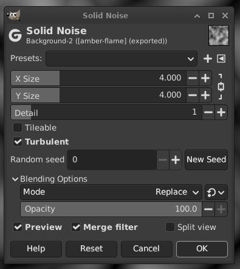
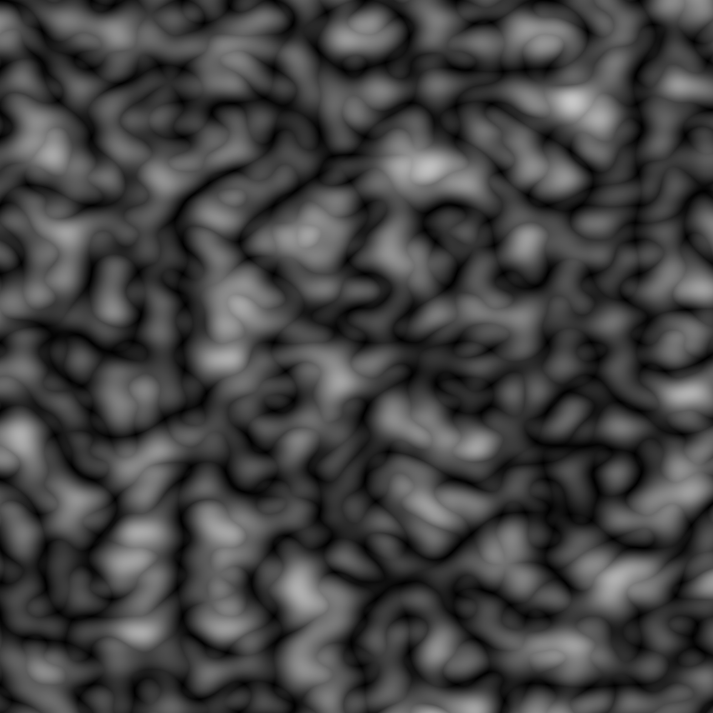
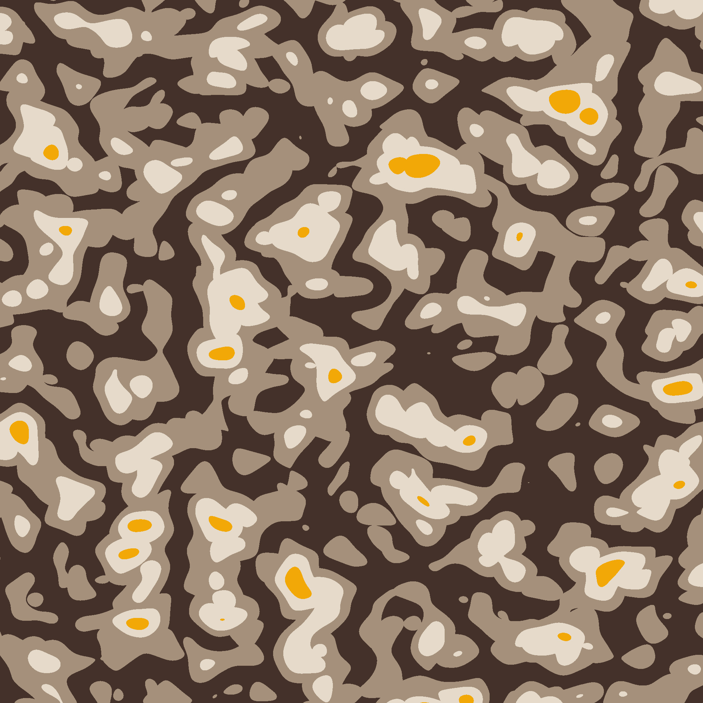

#+title: GIMP Tutorial - Abstract Background using Solid Noise

** Step 1: Black Canvas
Create a new document in GIMP with a plain white background.

** Step 2: Solid Noise filter
Apply the *Solid Noise filter* using the menu, Filter -> Render -> Noise -> Solid Noise
Make sure to turn on the ~Turbulent~ setting.

After applying the filter, your design should look something like this:

** Step 3: Apply a Palette Map
Apply a *Palette map* using a five color palette , Colors -> Map -> Palette Map

** Step 4: Enhance the image using Noise reduction filter
Finally enhance the image , Filters -> Enhance -> Noise Reduction

[[../images/gimp-abstract-bg-solid-noise-04.jpg]]

** Final thoughts
Experiment with different color palettes. You can also do an invert image before applying the palette map
for different color variations within the same palette also.
